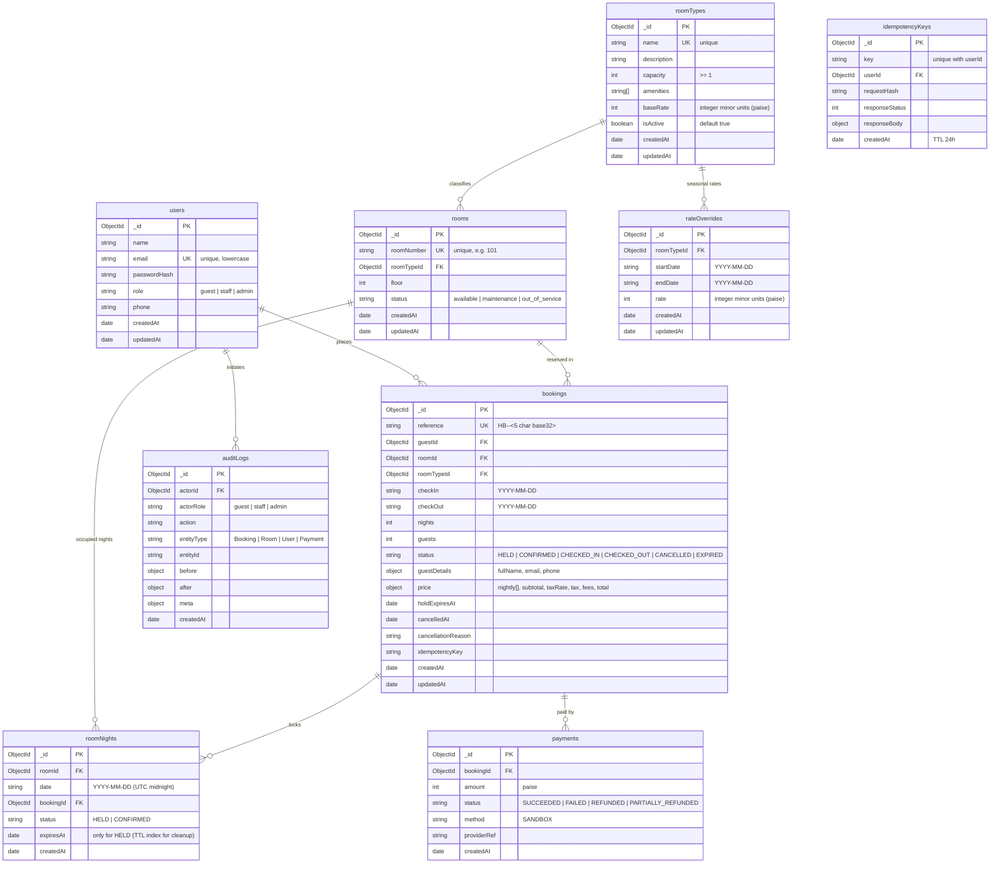

# Entity Relationship Diagram

### Critical Concurrency & Database Rules:
1. **The Unique-Index Trick**: `roomNights` has `{ roomId: 1, date: 1 }` UNIQUE index. One document per room per occupied night. The check-out date is NOT a night, enabling same-day turnover.
2. **MongoDB Multi-Document Transactions**: `session.withTransaction()` guarantees atomic hold, payment, and state changes.
3. **Idempotency**: `idempotencyKeys` with `{ key: 1, userId: 1 }` UNIQUE index ensures safe retries without double-charging or duplicate bookings.
4. **State Machine**: Enforced via central `TRANSITIONS` dictionary across all endpoints.
